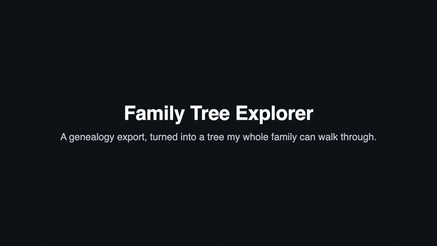

# Family Tree Explorer

An interactive family tree that turns a standard GEDCOM genealogy export into a searchable pedigree. It works by touch, mouse or TV remote.

[](https://copezetic.github.io/family-tree-explorer/media/family-tree.mp4)

[Open the full video](https://copezetic.github.io/family-tree-explorer/media/family-tree.mp4) or [try the sample version](https://copezetic.github.io/family-tree-explorer/).

I direct this work through Claude Code and own the design, testing and upkeep.

**The video shows my real family tree.** The code in this repo runs on a made-up sample, so everyone in the live demo is fictional and no family data is stored here.

## What it does

- **Search** anyone by name, year or place. Names that start with what you typed rank first.
- **Walk the line:** a trail across the top shows the route back to the start, one tap per generation.
- **Person panel:** tap a card for dates, places, family and siblings. Tap again to start the tree from that person.
- **Input:** drag, pinch, scroll, keyboard or remote arrows.

## Protecting living people

`gedcom_to_tree.py` applies a privacy rule while it builds the data. Anyone with no death record who was born after 1925, or has no birth year, gets a name and birth year only. It also checks children's birth years, so a bad date cannot wrongly mark someone as living.

## Try it


Open `index.html` in a browser. To rebuild the data:

```bash
python3 gedcom_to_tree.py sample/sample.ged Alex > tree.js
```
